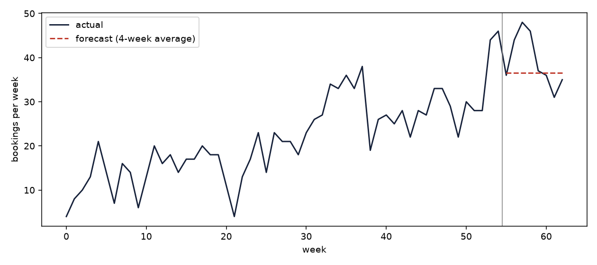

# Weekly demand forecast for a small cleaning company

Klira is my own cleaning company. I built this project to answer a question I have every week: how many bookings will come in, and how many cleaners do I need? It works from a booking log, using SQL and Python, and checks the forecast on weeks the model has not seen.

The data in this repository is simulated. It is not Klira's real records (see below).

## The finding

The simplest method won. A plain 4-week average predicted weekly bookings with an 11.0% error on the 8 held-out weeks. A regression with a trend and a yearly seasonal cycle did worse, at 13.2%.

| model | MAE (bookings) | MAPE % |
|:--|--:|--:|
| last value | 7.38 | 21.1 |
| 4-week average | 4.62 | 11.0 |
| trend + season regression | 5.59 | 13.2 |



The dark line is actual bookings per week. The dashed red line is the forecast for the last 8 weeks, which the model did not see.

Why the simple model won: the log covers 63 weeks. That is barely more than one year, so the regression sees each season only once and cannot tell a yearly pattern from noise. With so little history, averaging the last month is the safer bet.

## The data is simulated

`data/bookings_sample.csv` is generated with random numbers and a fixed seed, shaped like the records of a small cleaning service (1,556 bookings). It is not real company data. The forecast comparison above is a fair test of the method, but the channel, service and repeat-client figures in `reports/results.md` only reflect how the generator was set up. They show that the queries work, and nothing more.

To run the analysis on real records, save them as `data/bookings.csv` with the same columns (`booking_id, date, client_id, service, channel, hours, revenue`). The script uses that file first, and it is git-ignored so private data is never uploaded.

## What the business does with it

The forecast turns into a staffing number: forecast bookings x average hours per booking / 30 billable hours per cleaner per week. On the simulated data that gives 6 cleaners for each of the 8 test weeks. The 30 hours is an assumption, and because a 4-week average predicts the same value for every week ahead, the staffing number is flat too. It is a baseline to plan around, and it should be recalculated each week as new bookings arrive.

## Questions the project answers

1. How many bookings should we expect each week, and how many cleaners does that need?
2. Which acquisition channel brings the most revenue?
3. Which service earns the most per hour?
4. What share of clients come back?

## How it works

- `sql/queries.sql` has four queries: weekly bookings, channel performance, service mix and repeat-client rate.
- `src/analyze.py` loads the CSV into SQLite, runs the queries, holds back the last 8 weeks and compares three forecasts on them. It writes `reports/results.md` and `reports/forecast.png`.
- `src/make_sample_data.py` creates the simulated booking log.

Error is measured two ways. MAE is the average miss in bookings per week. MAPE is the same miss as a percentage of the actual value.

## Limits

- The data is simulated, so no conclusion here describes a real business.
- 63 weeks cannot show a yearly pattern reliably.
- The model knows nothing about holidays, weather or price changes.
- The forecasts are tested on one 8-week window. Testing on several windows would give a more reliable ranking.

## Next steps

- Run it on Klira's real booking records.
- Try exponential smoothing, which weights recent weeks more.
- Test over several time splits.

## Run it

```bash
pip install -r requirements.txt
python src/make_sample_data.py   # skip if you have data/bookings.csv
python src/analyze.py
```
